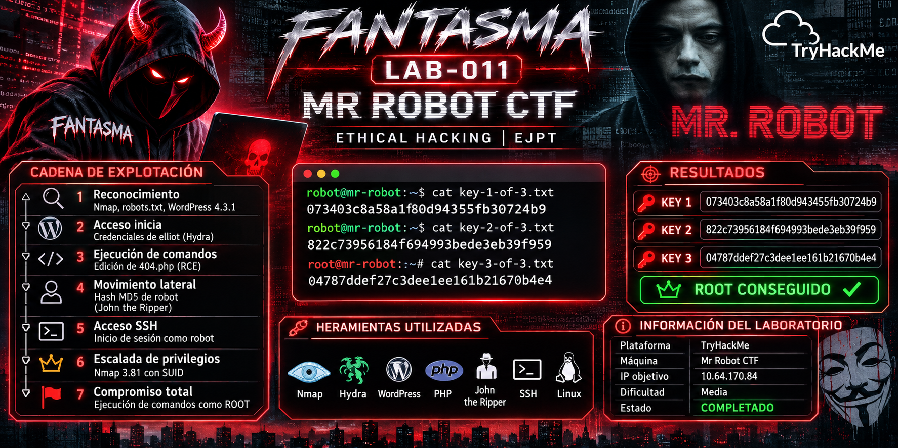

# 😈 FANTASMA | LAB-011 — MR ROBOT CTF

## Información del laboratorio

| Campo | Detalle |
|---|---|
| Plataforma | TryHackMe |
| Máquina | Mr Robot CTF |
| Laboratorio | LAB-011 |
| IP objetivo | 10.64.170.84 |
| Dificultad | Media |
| Estado | COMPLETADO |
| Autor | FANTASMA |

## Objetivo

Comprometer la máquina del laboratorio, recuperar las tres claves y demostrar escalada de privilegios hasta ROOT.

## 1. Reconocimiento

- Enumeración de servicios HTTP y SSH.
- Identificación de WordPress 4.3.1.
- Descubrimiento de `robots.txt`.
- Localización de `fsocity.dic` y primera clave.

## 2. Acceso inicial

- Usuario WordPress identificado: `elliot`.
- Contraseña recuperada mediante Hydra.
- Acceso al panel administrativo.
- Modificación autorizada de `404.php` del tema Twenty Fifteen.
- Confirmación de ejecución de comandos como `daemon`.

## 3. Movimiento lateral

- Enumeración del directorio `/home/robot`.
- Archivo encontrado: `password.raw-md5`.
- Hash MD5: `c3fcd3d76192e4007dfb496cca67e13b`.
- Recuperación de contraseña mediante John the Ripper.
- Acceso SSH como usuario `robot`.

## 4. Escalada de privilegios

- `sudo -l`: acceso denegado.
- Enumeración de ejecutables SUID.
- Identificación de `/usr/local/bin/nmap`.
- Versión vulnerable: Nmap 3.81.
- Ejecución de comandos desde modo interactivo.
- Privilegios confirmados: `uid=0(root)`.

## 5. Claves recuperadas

| Clave | Valor |
|---|---|
| KEY 1 | `073403c8a58a1f80d943455fb30724b9` |
| KEY 2 | `822c73956184f694993bede3eb39f959` |
| KEY 3 | `04787ddef27c3dee1ee161b21670b4e4` |

## 6. Herramientas utilizadas

Nmap, Hydra, Curl, WordPress, PHP, John the Ripper, SSH y Linux.

## 7. Recomendaciones de seguridad

- Mantener WordPress y sus componentes actualizados.
- Restringir el acceso al editor de temas.
- Evitar contraseñas débiles y hashes MD5 para almacenar contraseñas.
- Auditar periódicamente los ejecutables SUID.
- Eliminar versiones obsoletas de herramientas privilegiadas.
- Aplicar el principio de mínimo privilegio.

## Conclusión

Se completó la cadena de explotación desde el reconocimiento web hasta la ejecución de comandos con privilegios ROOT, recuperando las tres claves del laboratorio.

**FANTASMA | Ethical Hacking — eJPT**
